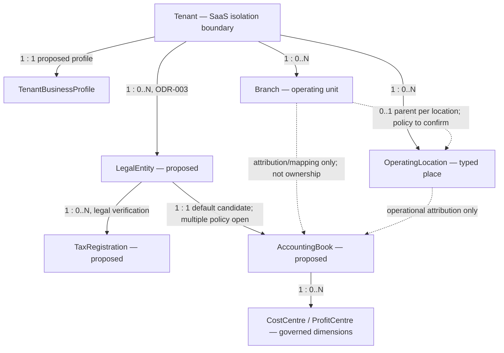

# Tenant, Branch, Legal Entity and Accounting Boundary Analysis

**Document ID:** DBR-002  
**Status:** Decision-support analysis — ODR-001 operating-model decision approved; legal/accounting concepts remain conceptual and are not current development blockers  
**Date:** 2026-11-17  
**Authority:** Project Vision and Scope; Canonical Business Glossary; Core Domain Entity Catalogue; Module Dependency Map; ERS-001; ARC-TEN-001; ARC-SYS-001; DBR-001; Open Decisions Register (ODR-001..003); Accounting Double-Entry and Financial Controls; Tax Configuration and Reporting specifications.  
**Purpose:** Reconcile the existing tenant, branch, operating-location and accounting concepts; expose unresolved cardinalities and modelling gaps; recommend a configurable conceptual direction without closing owner/legal/accounting decisions.

## 1. Executive conclusion

The existing documentation consistently establishes four important distinctions:

1. **Tenant** is the SaaS isolation and business-workspace boundary. It is not automatically a legal entity.
2. **Branch** is a tenant-owned operating unit. Its count and identity are independent of GST registration.
3. **OperatingLocation** is a typed operational place (for example outlet, warehouse, collection centre, processing site or stock location). It is not automatically a branch or legal entity.
4. **Accounting books** and legal/tax identity must not be inferred from branch membership.

These principles are already present in the glossary, ERS-001, ARC-TEN-001 and ARC-SYS-001. This analysis preserves them.

**Material gap:** ERS-001 describes invoices and other financial records as being in a “Tenant/books scope”, and the accounting architecture requires books-specific chart of accounts and posting, but ERS-001 does not yet define a canonical LegalEntity, TaxRegistration or AccountingBook entity and their cardinalities. DBR-001 already identifies this as an unresolved dependency.

**Recommended conceptual direction for further design:** keep Tenant, Branch, OperatingLocation, LegalEntity, TaxRegistration and AccountingBook as distinct concepts. Support a simple one-legal-entity / one-accounting-book tenant profile as a possible initial configuration, while allowing the model to represent additional legal entities, registrations or books only where explicitly enabled and approved. This is a modelling recommendation, not a decision that every tenant must support multiple entities or books.

Do not add final legal/tax cardinalities or statutory behaviour by assumption. Under the product owner's 2026-11-18 scope instruction, Indian legal/regulatory review is deferred until after project completion and is not a current development blocker. ODR-002 remains a business/domain decision; ODR-003's multi-legal-entity and tax-registration details are outside the current legal review scope. Accounting-book and operational data-boundary design may continue using explicit provisional conceptual boundaries, without claiming legal conclusions.

## 2. Existing source-of-truth statements

| Source | Existing statement | Consequence for this analysis |
|---|---|---|
| Canonical Business Glossary | Tenant is a technical/commercial boundary, not automatically a legal entity | Never equate Tenant and LegalEntity |
| Canonical Business Glossary | Branch is an operating unit; its relationship to legal registration remains open | Branch cannot own tax/legal identity by assumption |
| Canonical Business Glossary | Outlet, collection centre, warehouse/stock location, processing unit and service area are distinct terms | Do not collapse all places into Branch |
| Core Domain Entity Catalogue | Tenant Business Profile may hold multiple registrations only if ODR-003 is approved | Multi-registration support remains conditional |
| Core Domain Entity Catalogue | Branch taxonomy is open; operational locations are typed | Keep location hierarchy configurable pending ODR-002 |
| ERS-001 | TenantBusinessProfile is separate from Branch; Branch may have child operating locations | Preserve current logical distinction |
| ERS-001 | OperatingLocation belongs to Tenant and may optionally be parented to Branch | A location may be tenant-wide/unassigned or branch-associated under policy |
| ERS-001 | Invoice and selected financial records have “Tenant/books scope” | Books ownership requires an explicit model |
| ARC-TEN-001 | Branch count is independent of GST registration; branch scope is checked separately from tenant scope | Never derive GST/legal identity from branch count |
| ARC-SYS-001 | AccountingEntity/books scope remains separate from Tenant and Branch | Maintain the cross-document boundary |
| ODR-001 | The business operating-model decision is resolved: one Tenant may support multiple dairy operating models and branches. Legal-form classification is deferred to the post-project legal review and is outside current development scope | Do not use legal-form classification as a current tenant onboarding or architecture blocker |
| ODR-002 | Branch/outlet/collection/warehouse/processing/service-area taxonomy is unresolved | Location cardinalities and parentage are not final |
| ODR-003 | Whether one tenant may contain multiple legal entities or GST registrations is unresolved | Multi-entity/multi-registration cardinality is not approved |

## 3. Conceptual terms and boundaries

### 3.1 Tenant

A tenant is the SaaS customer workspace and primary isolation boundary. It owns tenant business data, configuration, users/memberships, operational capabilities and the commercial SaaS subscription.

A tenant may represent the software workspace of a real-world business, but this does not prove that the business is one legal person, one GST registration, one branch or one accounting book.

### 3.2 LegalEntity — proposed explicit concept

A legal entity represents the person or organization that has legal rights/obligations and is the subject of the relevant legal/accounting records. Candidate business forms and the evidence required for identity verification are governed by ODR-001 and must be validated for the intended Indian operating context.

This concept must not be replaced by Tenant or Branch.

### 3.3 TaxRegistration — proposed explicit concept

A tax registration represents a registration identifier held by a legal entity under a specific tax regime and jurisdiction, with its own effective dates and verification state. A GSTIN is an example of a registration identifier, not a synonym for Branch or LegalEntity.

The exact relationship between legal entity, GST registrations, place of business, state/jurisdiction, returns and invoice rules requires current official legal/tax verification. This document does not assert statutory cardinalities or tax applicability.

### 3.4 AccountingBook — proposed explicit concept

An accounting book is a governed accounting ledger/book set with a defined owner, currency, chart-of-accounts version, financial period/calendar, posting policy and close/reopen controls.

The book is not synonymous with Tenant, Branch, GST registration, Cost Centre or Profit Centre. A single legal entity may require more than one reporting/operational dimension without creating separate legal entities. Whether the product should support multiple independent books per legal entity is a separate accounting/product decision.

### 3.5 Branch

A Branch is an operating unit within a tenant. It can be used as an operational, authorization, reporting or attribution dimension. It must not be assumed to be a legal entity, tax registration, accounting book, warehouse or outlet.

### 3.6 OperatingLocation

An OperatingLocation is a typed physical/operational place. Candidate types already used by the project include outlet, warehouse, collection centre, processing site and stock location. The project must define the controlled location-type catalogue, parent/child rules, address requirements and capability rules. ServiceArea remains geographic coverage, not a physical OperatingLocation.

## 4. Candidate conceptual relationship model

The following is a **candidate for further modelling**, not an approved final cardinality or physical ERD.

The diagram intentionally distinguishes ownership relationships from attribution/mapping. Dotted lines are not proposed foreign-key commitments.

## 5. Relationship alternatives and implications

### 5.1 Tenant to LegalEntity

| Alternative | Description | Advantages | Risks / implications | Assessment |
|---|---|---|---|---|
| A — exactly one | Each tenant must have exactly one LegalEntity | Simple onboarding, books, invoice identity and accounting | Excludes tenants with multiple legal entities; may force multiple tenants for one customer organization | Viable only if product scope explicitly limits tenant structure |
| B — one or more | Each active tenant must have at least one LegalEntity; multiple are supported | Represents more complex business groups under one SaaS workspace | Requires entity-aware access, books, tax profiles, reporting, billing and integrations | Most flexible conceptual model; ODR-003 and owner approval required |
| C — optional legal profile | Tenant may operate before legal identity is configured; one or more entities added later | Supports trial/setup workflows and businesses whose legal profile is not yet verified | Must prevent regulated/financial actions until required identity data is verified | Useful onboarding capability; must define activation gates |

**Recommended modelling posture:** avoid a hard-coded one-to-one database assumption. Permit an explicit tenant-to-legal-entity association in the logical model, with tenant configuration and business rules restricting the initial operational profile to one verified legal entity where that is the approved launch policy. This is not approval of multi-entity functionality in V1.

### 5.2 LegalEntity to TaxRegistration

| Alternative | Description | Implications |
|---|---|---|
| A — one registration only | One registration per legal entity | Simplest; can be too restrictive for multi-jurisdiction operations |
| B — multiple registrations | One legal entity may have multiple tax registrations across relevant regimes/jurisdictions | Registration-specific tax configuration, invoice identity, effective dates, filing and reconciliation are required |
| C — generic registration model | Registration records are typed by regime and jurisdiction, with GSTIN as one subtype/value | More extensible; needs strict validation, uniqueness and effective-date rules |

**Recommended modelling posture:** use a generic TaxRegistration concept with a typed tax regime/jurisdiction and regime-specific validated fields. Treat multiple registrations as conditional capability until legal/tax research and ODR-003 are closed. Do not encode a universal GSTIN count or legal rule in the schema based only on this proposal.

### 5.3 LegalEntity to AccountingBook

| Alternative | Description | Implications |
|---|---|---|
| A — one book per legal entity | One authoritative financial ledger/book set per legal entity | Simplifies posting, period close and statutory reports |
| B — multiple books per legal entity | Separate books for defined accounting/reporting requirements | Requires book selection, inter-book controls, consolidated reporting and strict posting ownership |
| C — one tenant-wide book | Tenant has a single book regardless of legal entities | Risks combining separate legal obligations and balances; should not be assumed where multiple legal entities exist |

**Recommended modelling posture:** AccountingBook must be explicitly owned by a LegalEntity in the conceptual model. One default book per legal entity is the simplest candidate baseline. Additional books require a documented business/accounting use case and owner/accountant approval. A tenant-wide book shared by multiple legal entities must not be the implicit default.

### 5.4 Branch and OperatingLocation

| Alternative | Description | Advantages | Risks / implications |
|---|---|---|---|
| A — Branch is the only location | All outlets, collection points, warehouses and facilities become branches | Simple location filtering | Violates glossary distinctions; inflates branch count and conflates permissions/entitlements with facilities |
| B — Branch with typed child locations | Branch is an operating unit; typed locations can be associated with it | Matches current ERS and glossary; supports multiple stock/collection/outlet locations per branch | Needs controlled types and parentage rules |
| C — tenant-wide typed locations | All physical locations belong directly to tenant; optional branch attribution | Flexible for shared or independent facilities | Requires clear branch assignment and access rules; location may have no branch |
| D — mixed model | Locations are tenant-owned and may optionally be associated with a branch; some location types may have typed parent/child relations | Flexible and consistent with current ERS wording | Requires explicit hierarchy rules and prevention of invalid combinations |

**Recommended modelling posture:** preserve the existing ERS baseline: every OperatingLocation belongs to the tenant and may optionally be associated with a Branch. Do not assume every location is a child of exactly one branch. Define whether a location may be shared by branches, reassigned over time, or nested under another location only after workflow analysis. Branch itself remains a distinct tenant-owned operating unit.

## 6. Worked scenarios for validation

These scenarios are illustrative tests of the conceptual boundaries. They are not claims that every scenario must be supported in the first release.

### Scenario 1 — Small dairy with one operating unit

- One tenant represents the dairy workspace.
- One legal entity and one accounting book are configured.
- One branch is used for day-to-day operations.
- The branch has a counter/outlet location, a stock location and possibly a collection point.
- GST/tax registration is recorded only where verified and applicable.

Expected result: no need to create separate tenants or legal entities merely because there are multiple physical locations.

### Scenario 2 — One dairy business with multiple branches

- One tenant has multiple branches.
- Each branch may have one or more typed operating locations.
- Users may be scoped to one branch or multiple branches under authorization policy.
- Tenant-wide masters and branch-attributed operational records remain distinct.
- A branch is not automatically a separate legal entity, GST registration or accounting book.

Expected result: adding a branch does not silently create a new legal entity or registration.

### Scenario 3 — One legal entity with operations in multiple jurisdictions

- One tenant may need to represent the business workspace.
- One legal entity may have multiple tax registrations if verified under applicable law.
- Branches and operating locations are mapped to the relevant operational/tax profile only under approved tax rules.
- Invoice and return behaviour must resolve the correct registration based on verified transaction facts and effective dates.

Expected result: registration is explicit and versioned; it is not inferred from branch name or branch ID.

### Scenario 4 — Business group with multiple legal entities

- One tenant may be considered for multiple legal entities only if ODR-003 is approved.
- Each entity has its own accounting book by default in the proposed model.
- Shared users, products, locations, procurement or inventory require explicit cross-entity sharing/transfer rules and audit.
- Consolidated reporting, inter-entity balances and eliminations require separate accounting design.

Expected result: records cannot silently cross legal-entity/book boundaries simply because they share one tenant.

### Scenario 5 — Independent warehouse or collection centre

- A physical warehouse or collection centre may belong directly to the tenant and optionally be associated with a branch.
- Stock custody, procurement session and operational permissions reference the specific typed location.
- It does not become a legal entity or branch merely because it has its own address.

Expected result: physical custody/location and legal ownership are separate attributes.

## 7. Financial and operational record ownership rules

The following are proposed invariants for subsequent ERS refinement:

1. Tenant ownership is mandatory for all tenant-owned legal, operational and accounting records.
2. LegalEntity ownership is mandatory for records whose legal/accounting meaning is entity-specific, once the legal entity model is approved.
3. TaxRegistration must be referenced explicitly on tax-sensitive documents when the verified tax policy requires it; never derive it solely from Branch.
4. AccountingBook must be explicit on posted journals and book-controlled balances; do not derive it from Tenant or Branch.
5. Branch attribution is optional for tenant-wide records and required only when the business workflow/accounting policy calls for it.
6. OperatingLocation attribution is typed and purpose-specific: stock custody, collection, processing, outlet/POS and service location are not interchangeable.
7. CostCentre and ProfitCentre are analytical/accounting dimensions; they are not substitutes for LegalEntity, Branch or AccountingBook.
8. Cross-entity stock transfers, receivables/payables, shared expenses and inter-entity transactions require explicit paired records, approvals, reconciliation and audit. No cross-entity posting is implied by shared tenant membership.
9. Legal identity, tax registration, accounting book, branch and location changes must be effective-dated where historical transactions depend on the earlier value.
10. Posted documents retain the identity, registration, book and policy snapshots used at posting; changing a profile must not rewrite historical documents.

## 8. Required ERS-001 refinement

When the dependencies are resolved, update ERS-001 with:

- Canonical definitions and ownership of LegalEntity, TaxRegistration and AccountingBook.
- Tenant-to-LegalEntity cardinality and tenant activation/verification state.
- LegalEntity-to-TaxRegistration cardinality by regime/jurisdiction, including effective dates and validation status.
- LegalEntity-to-AccountingBook cardinality and default-book rule.
- Relationship of TenantBusinessProfile to LegalEntity, without making profile itself the legal person.
- Relationship of Branch and OperatingLocation to operational workflows, including optional/shared location mapping rules.
- Explicit LegalEntity, TaxRegistration and AccountingBook references on relevant invoice, tax, journal, subledger, payment and reconciliation records.
- Entity-aware permissions, audit, exports, reports, Tally company mappings and integration boundaries.
- Tenant-safe and entity/book-safe composite ownership constraints in the later physical database design.

Do not apply these refinements as if they were approved until the decision gates below are met.

## 9. Decision and evidence gates

| Decision | Current status | Required closure evidence / approval |
|---|---|---|
| ODR-001 — tenant operating models | **Resolved — user-approved 2026-11-18** | Option B approved: one Tenant supports multiple dairy operating models and multiple branches. Legal-form review is post-project and outside current scope |
| ODR-002 — branch/location taxonomy | Unresolved | Domain workflow map for outlet, collection, warehouse, processing, stock and service areas; user-facing terminology and permission consequences |
| ODR-003 — tenant/legal entity/GST registration relationship | Unresolved | Current official GST/legal research, accounting implications, representative scenarios and explicit product-owner approval |
| AccountingBook cardinality | Not separately resolved in ODR | Accounting workflow scenarios, statutory/reporting needs, Tally mapping and accountant/owner approval |
| Cross-entity operations | Not separately resolved in ODR | Explicit use cases, inventory/finance controls, audit and authorization analysis |
| Shared locations / multi-branch mapping | Not separately resolved in ODR | Physical operations and stock-custody scenarios, permission/reporting consequences |

ODR-001's operating-model decision is resolved by explicit product-owner approval dated 2026-11-18. The legal-form aspect formerly mixed into ODR-001 is deferred to the post-project legal review and is not a current development blocker. ODR-002 remains a business/domain decision for owner review. ODR-003's legal-entity and tax-registration applicability is outside the current legal review scope; only non-legal accounting and data-boundary modelling may proceed provisionally where required. No legal conclusion or final accounting cardinality is implied.

## 10. Consistency review against existing documentation

| Existing document | Consistency check | Result |
|---|---|---|
| Canonical Business Glossary | Tenant, Branch, Outlet, Collection Centre, Warehouse/Stock Location, Processing Unit and Service Area remain distinct | Consistent |
| Core Domain Entity Catalogue | Tenant Business Profile, Branch and Operational Location remain distinct; multi-registration remains conditional on ODR-003 | Consistent |
| ERS-001 | Retains TenantBusinessProfile, Branch and optional Branch-parented OperatingLocation; no final LegalEntity/TaxRegistration/AccountingBook cardinality is asserted | Gap documented, no contradiction introduced |
| ARC-TEN-001 | Tenant is isolation boundary; Branch is operating unit; GST independence and separate location semantics preserved | Consistent |
| ARC-SYS-001 | AccountingEntity/books scope remains separate from Tenant and Branch | Consistent; terminology needs a future canonical mapping between “AccountingEntity” and the proposed LegalEntity/AccountingBook concepts |
| DBR-001 | Legal/business identity, branch taxonomy and tenant-to-legal-entity/books are identified as unresolved database dependencies | Consistent |
| Module Dependency Map | Branch/location remains prerequisite context for operations, not a legal entity | Consistent |
| Open Decisions Register | ODR-001..003 remain unresolved and unmodified | Consistent |

### Terminology issue to resolve

ARC-SYS-001 currently uses “AccountingEntity/books scope” as a combined phrase. The candidate model in this analysis separates LegalEntity (legal person), AccountingBook (ledger boundary) and TaxRegistration (tax identity). Before physical modelling, reconcile that phrase in ARC-SYS-001 and related accounting documents so that “AccountingEntity” is not used ambiguously as both a legal entity and an accounting book. Do not rename existing entities mechanically; first confirm their intended meaning in the accounting source documents.

## 11. Explicit non-goals

- No legal or tax conclusion on which registrations a particular dairy business must hold.
- No final decision that a tenant can or cannot contain multiple legal entities or GST registrations.
- No final decision that every legal entity must have exactly one accounting book.
- No assumption that every branch requires a GSTIN or separate books.
- No final location hierarchy, shared-location policy or branch-to-location cardinality.
- No physical ERD, SQL DDL, ORM models, migrations, application code or database provisioning.
- No change to ODR-001, ODR-002 or ODR-003 status.

## 12. Exit criteria

This analysis can be promoted into an approved logical model only after:

- ODR-001's approved operating-model decision is propagated consistently; ODR-002's business/location taxonomy is approved or explicitly classified.
- Legal/tax applicability is not a current development gate under the product owner's 2026-11-18 scope instruction; it is reserved for post-project review.
- AccountingBook ownership, chart-of-accounts scope, financial periods, posting and close controls are reconciled with the accounting specifications and Tally mapping.
- Branch and OperatingLocation taxonomy is validated against all operational workflows.
- Cross-entity access, transfers, consolidation and reporting requirements are either explicitly supported or explicitly excluded.
- ERS-001, ARC-TEN-001, ARC-SYS-001, the glossary, entity catalogue and accounting documents are updated together under a single change-control pass.
- DBR-001 readiness checklist and Gate D evidence are updated.

Until then, this document is decision-support analysis only. ERS-001 remains the proposed logical baseline, and physical database schema generation remains gated.

## 13. Product-owner scope decision recorded on 2026-11-18

The product owner approved ODR-001 Option B: one Tenant represents one independent Dairy Business Workspace and may support multiple dairy operating models and multiple branches. This is a business-operating-model decision; it does not approve or imply any legal-entity, tax-registration or accounting-book cardinality.

The product owner separately instructed that Indian legal and regulatory review will occur after project completion. Such review is outside the current development scope and must not be shown as a current blocker or unresolved development decision. This scope boundary does not remove the need to model operational, accounting and data-integrity boundaries correctly; it prevents the project from making legal conclusions at this stage.
