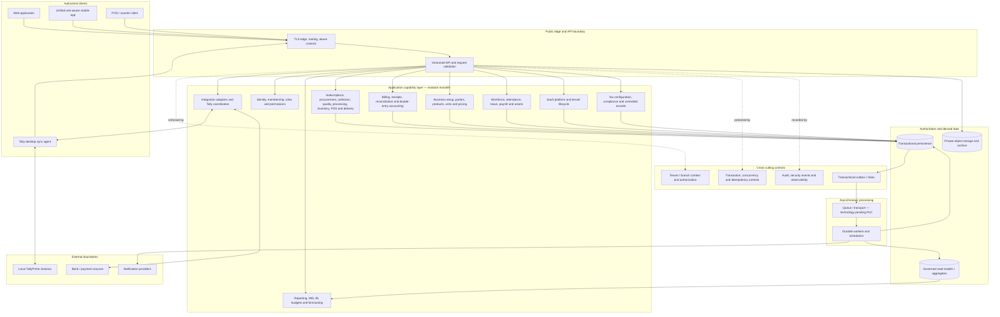
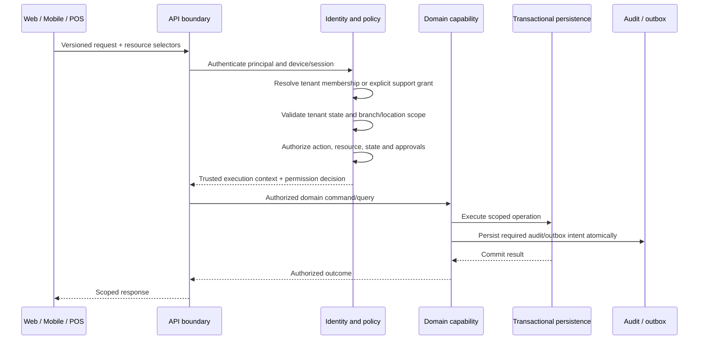
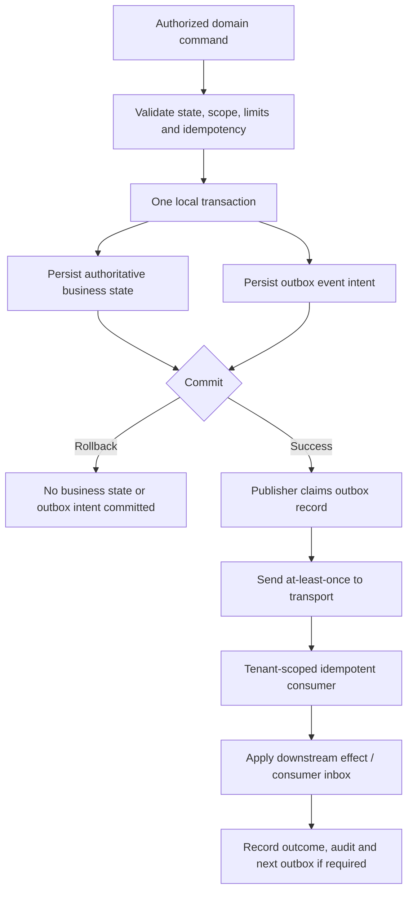

# System Architecture Overview and Integration Map

**Document ID:** ARC-SYS-001  
**Status:** Technology-neutral system integration baseline — component policies remain authoritative; final technology and production decisions are gated by evidence and owner approval  
**Product:** Dairy ERP SaaS (India)  
**Authority:** Project Vision and Scope; Domain Landscape and Capability Model; Module Dependency Map; FRS-001; NFR-001; ERS-001; ARC-TEN-001; ARC-IAM-001; ARC-API-001; ARC-MOB-001; ARC-CONC-001; ARC-EVT-001; ARC-STO-001; ARC-DR-001; ARC-SCALE-001; ARC-BI-001; ARC-DEP-001; ARC-SEC-001; ARC-OBS-001; Tally Desktop Synchronization and Data Exchange Architecture; ODR-001..034 as applicable.  
**Purpose:** Provide one navigable system-level view of the platform, its logical boundaries, runtime interactions, data ownership, security context and integration paths. This document connects existing architecture specifications; it does not replace or duplicate their detailed rules.

## 1. Scope and interpretation

This is the system-level architecture map for a multi-tenant Dairy ERP SaaS serving Indian dairy businesses with different operating models: resale, loose-milk distribution, recurring home delivery, procurement, collection, processing, packaging, counter sales and multi-branch operations.

The architecture must preserve the full approved product scope while allowing each tenant to enable only the capabilities relevant to its actual business. It must support web, mobile and API clients. Customer login and customer self-service access are excluded.

This document defines logical responsibilities and interactions. It does not approve a final programming language, framework, database, queue, hosting provider, deployment topology, commercial plan, legal interpretation or service-level commitment. Refer to the linked authoritative documents for detailed invariants and acceptance criteria.

### 1.1 Normative architecture rules

- The initial system shape is a **modular monolith** with explicit domain/module boundaries; independently scale API and worker processes where needed. Do not infer a microservice-per-module deployment.
- Business rules and authoritative calculations execute server-side.
- All clients use reviewed, versioned API contracts; clients must not independently implement authoritative posting, stock, pricing, billing or schedule rules.
- Tenant isolation, branch authorization, auditability, concurrency safety, idempotency and financial integrity are platform-wide controls.
- Transactional records and the posted double-entry ledger remain authoritative. Analytics, caches, exports and Tally exchange artifacts are derived or external representations.
- Asynchronous delivery is at-least-once unless an end-to-end guarantee is separately proven; consumers must be duplicate-safe.
- Production must be deployable on Linux VPS infrastructure. Docker is optional, not mandatory.
- Development-machine limits do not reduce product scope or production architecture requirements.

## 2. System context and external actors

### 2.1 Human and client actors

- Platform operations personnel administer SaaS tenants, plans, entitlements and platform controls through separately authorized platform capabilities.
- Tenant owners, managers, accountants, procurement/collection staff, POS/counter staff, inventory/processing staff, delivery personnel and other authorized employees use role-appropriate web or mobile workspaces.
- A user may use web or mobile according to their permissions; client type does not itself grant authority.
- Customers are business records maintained by authorized tenant personnel. They do not receive customer login accounts or customer-facing application access under the current product boundary.

### 2.2 External systems and providers

- TallyPrime is an optional external accounting interchange destination/source for customers who use it. It is connected through a separately installed, tenant-paired desktop synchronization agent; it is not the SaaS operational system of record.
- Payment sources include manual cash/payment recording, UPI QR, bank-account transfer and optional provider/gateway references. A payment gateway is not mandatory. A recorded payment and a verified/reconciled payment are distinct states.
- Banks/payment providers, notification providers and other partner systems are accessed through tenant-bound, explicitly configured integration adapters where selected.
- Object-storage providers are behind a provider-neutral storage abstraction. Cloudflare R2 and Backblaze B2 are candidates to evaluate, not production dependencies or free-tier guarantees.

## 3. Logical architecture

The following is a responsibility map, not a deployment diagram or a one-to-one service decomposition.

The diagram intentionally shows logical responsibilities. It does not prescribe process boundaries, database products, message brokers, network topology or deployment count.

## 4. Capability and ownership boundaries

The business-level dependency authority is the Module Dependency Map. The following grouping is a navigation aid; it does not transfer ownership away from the domain specifications.

| Capability group | Main responsibilities | Authoritative source documents |
|---|---|---|
| SaaS platform | Platform administration, tenant lifecycle, plans, entitlements and platform audit | Project Vision and Scope; SaaS and tenancy architecture; FRS-001; ODR |
| Organization and access | Tenant/business setup, branch/location, identity, membership, role, permission and device | Actor and Access Model; ARC-TEN-001; ARC-IAM-001 |
| Shared master data | Customer, supplier/farmer, product, unit, pack, price/rate and tax configuration | Domain specifications; ERS-001; business rules |
| Customer demand and fulfilment | Subscription recurrence, orders, POS, delivery routes/runs/stops and exceptions | Subscription, delivery, billing and workflow domain documents |
| Supply and operations | Milk procurement/collection, quality, purchased goods, processing, packaging, inventory, lots and traceability | Procurement, collection/quality, processing, inventory and batch/lot documents |
| Finance | Billing, receivables, receipts, payment allocation, cash/bank, expenses, payables, farmer settlement and double-entry accounting | Accounting, billing, cash/bank, expense and payroll domain documents |
| People and assets | Employee, attendance, shift, leave, payroll and maintenance | HR/payroll and asset domain documents |
| Compliance | Tax configuration, controlled evidence, hygiene/quality records and statutory reporting support | India tax and regulatory research documents; relevant domain specifications |
| Insight | Operational reports, financial statements, KPI, budget, forecast and scenario | ARC-BI-001; budgeting/analytics domain document |
| Integration | API clients, imports/exports, webhooks, payment/notification adapters and Tally agent coordination | ARC-API-001; integration-specific domain documents; Tally specifications |

A workflow may coordinate multiple capabilities. Each capability retains ownership of its business rules and authoritative records. A dependent module must not create a competing source of truth.

## 5. Client and API interaction

### 5.1 Shared server-side contract

Web, mobile and POS clients submit commands and queries through versioned API contracts. The API layer performs schema validation and routes use cases to the owning domain capability. Business calculations, state transitions, authorization, stock posting and financial posting remain server-side.

The public API, internal domain-event contracts and Tally-agent exchange schemas have independent versioning concerns. Do not treat them as one version number.

### 5.2 Role-aware clients

- Web is available to authorized business roles, not only owners.
- The initial mobile direction is one unified role-aware application with role-specific workspaces.
- Initial guaranteed offline support is limited to assigned delivery-run snapshots and delivery outcome capture with server revalidation, idempotent synchronization and explicit conflict handling.
- Offline POS, accounting posting, payment settlement, stock posting and master-data changes are not initially guaranteed.
- No customer login, customer portal or customer app is introduced by this architecture.

See ARC-MOB-001 for local data protection, device lifecycle, sync protocol and acceptance tests.

## 6. Tenant, branch and authorization context

Tenant is the primary business-data isolation boundary. Branch is a tenant-owned operating unit and an operational scope; it is not automatically a legal entity, GST registration, warehouse, cost centre or profit centre.

A tenant may have one or multiple branches independently of GST registration status. Operating locations such as outlets, warehouses, collection points and processing sites must retain their own typed meaning and must not be collapsed into the branch concept without an explicit business rule.

### 6.1 Protected request sequence

The exact framework middleware and database enforcement mechanisms remain technology-specific. The logical order and fail-closed behavior are mandatory.

### 6.2 Scope propagation

Tenant and branch context must be established from validated server-side identity/membership or a separately authorized platform workflow. A client-supplied tenant or branch ID is a selector, not proof of authority.

The same boundary applies to background jobs, events, reports, search, caches, exports, files, integrations and restore operations. Missing, invalid, suspended or ambiguous tenant context must fail closed. Context must not leak between concurrent requests or worker jobs.

## 7. Transactional write path and asynchronous side effects

Critical commands include subscription occurrence generation, delivery fulfilment, stock movement, POS sale/refund, procurement acceptance, payment receipt/allocation, farmer settlement, billing and accounting journal posting.

Each command must define its transaction boundary, business uniqueness key, idempotency identity, concurrency precondition, audit evidence, reversal/recovery path and deterministic tests. A retry after a timeout or lost response must not create a second business effect.

### 7.1 Local transaction and outbox

The outbox closes the unsafe database-commit/message-publish dual-write gap. It does not provide magical exactly-once delivery. A publisher may send twice after an uncertain acknowledgement; consumers must deduplicate and protect domain-level uniqueness.

Use asynchronous work for durable notifications, integrations, heavy reports, exports, forecasts and other justified long-running tasks. Do not introduce a broker for every function or allow analytics/notifications to block core POS, delivery or accounting posting unnecessarily.

## 8. Data ownership and source-of-truth boundaries

| Information | Authoritative owner | Derived/replicated representations |
|---|---|---|
| Tenant, membership, role, permission and entitlement | SaaS platform/identity domain | Client caches and permission projections, subject to invalidation |
| Customer, supplier/farmer, product, unit and price definitions | Owning tenant domain capability | Search indexes and read models |
| Subscription schedules and generated occurrences | Subscription domain | Delivery planning and billing projections |
| Delivery assignment and outcome | Delivery domain | Mobile offline snapshot and operational analytics |
| Stock quantity and movement | Inventory/stock ledger domain | Availability projections and reports |
| Procurement and quality acceptance | Procurement/quality domain | Supplier settlement, traceability and analytics projections |
| Receivable, payable, receipt and allocation | Finance subledger/domain | Statements, ageing and dashboards |
| Posted journals and account balances | Platform's double-entry accounting ledger | Financial statements, BI aggregates and Tally exchange batches |
| Audit and security history | Governed audit subsystem | Restricted operational dashboards and investigation exports |
| Files and evidence | Storage/document service with tenant ownership metadata | Authorized temporary download URLs and backup copies |
| KPI, budget and forecast | Governed analytics/budget capability for its own definitions and plans | Reports and scenario outputs; never operational transaction masters |

A stock projection, report aggregate, mobile cache, export file or Tally voucher is not a replacement for the authoritative source record.

## 9. Accounting and Tally boundary

The platform owns its operational data and its own double-entry ledger. Tally is an optional external accounting interchange boundary. The separately installed desktop agent initiates authenticated outbound communication to the SaaS service and connects locally to an explicitly selected TallyPrime instance/company. The SaaS backend must not require a public inbound connection to the customer's Tally machine.

The integration must use stable internal account, journal, voucher, party and branch/dimension identifiers, with Tally-specific GUIDs, names, voucher types and group mappings held in a versioned mapping layer. Every exchange batch must record company identity, period, mapping version, source references, duplicate handling, acknowledgement, errors and reconciliation state.

A generated export does not prove successful import or acceptance in Tally. An imported Tally record does not silently overwrite the platform ledger. Any supported import direction must have explicit ownership, conflict and reconciliation policy.

See the Tally Desktop Synchronization and Data Exchange Architecture and Tally Field and Voucher Mapping Specification for detailed contracts and version-specific proof-of-concept requirements.

## 10. Storage, reporting and recovery boundaries

- Transactional persistence owns operational and financial records.
- Object storage owns private file objects and archival artifacts behind a provider-neutral interface.
- Cloudflare R2 and Backblaze B2 remain candidates for cost/feature evaluation. Free-tier quotas must not be assumed in production capacity or continuity plans.
- Backups must be independently protected and restorable; object storage and database recovery must be reconciled with queues/outbox and external effects.
- Analytics begins with governed read models/pre-aggregations and only moves to a separate analytical store when measured workload requires it.
- Reports and exports must preserve tenant/branch authorization and record source cutoff/definition versions where reproducibility matters.
- Forecasts, budgets, targets and scenarios remain semantically distinct from actual posted transactions.

## 11. Security and trust boundaries

The principal trust boundaries are:

1. Public internet to edge/API.
2. Client device/local offline storage to server.
3. Tenant and branch boundaries inside shared application execution.
4. API process to worker/event execution.
5. Application to database and object storage.
6. SaaS integration boundary to banks, payment/notification providers and webhooks.
7. SaaS to customer-controlled Tally agent and local Tally instance.
8. Platform support/admin access to tenant business data.
9. Backup/restore and export operations to protected production data.

Security controls must include authentication, server-side authorization, tenant/branch isolation, least privilege, secrets management, encryption, rate/abuse controls, file scanning/validation as appropriate, auditability, privacy controls, incident response and tested recovery. Platform role or support status does not imply unrestricted tenant-data access. Exceptional support access requires a separate scoped, justified, time-limited and audited grant.

ARC-SEC-001, ARC-IAM-001, ARC-TEN-001 and ARC-OBS-001 remain authoritative for detailed security controls and verification.

## 12. Deployment and runtime topology

The logical runtime consists of:

- Public edge/reverse proxy and TLS termination.
- Application/API process tier.
- Independently managed worker/scheduler processes.
- Transactional database tier.
- Private object storage and independent backup destinations.
- Queue/transport where justified by durable asynchronous workload.
- Monitoring, logs, metrics, traces, alerting and operational access controls.

A compact single-VPS profile may be considered for a limited pilot only with explicit single-host risk acceptance and independent recovery. A separated database tier is the recommended production direction to evaluate first, subject to workload, provider, network, cost and operational evidence. Linux VPS deployment must remain possible without Docker being mandatory.

No server has been provisioned and no deployment, hardening, backup restore, load test or DR exercise is claimed by this document.

## 13. Technology decision boundary

The current technology document ADR-TECH-001 is a shortlist and PoC plan, not final approval. Preferred PoC directions are ASP.NET Core/.NET 10 LTS, PostgreSQL 18 and Flutter; Laravel 13, MySQL 8.4 and React Native remain alternatives. The selected stack must be determined through repeatable vertical slices, compatibility/security tests, concurrency and recovery evidence, team capability review and operational cost assessment.

The queue, cache, search, object-storage provider, API versioning mechanism, deployment automation and analytics storage choices also remain subject to their relevant proof-of-concept or owner-approval gates.

## 14. Cross-document authority map

| Concern | Authoritative document |
|---|---|
| Product scope and fixed boundaries | Project Vision and Scope |
| Business capability dependencies | Domain Landscape and Module Dependency Map |
| Actors and business access concepts | Actor and Access Model |
| Functional and non-functional behavior | FRS-001; NFR-001; Business Rules Catalogue; state/exception matrices |
| Canonical entities and logical relationships | ERS-001 |
| Tenant and branch isolation | ARC-TEN-001 |
| Authentication and authorization | ARC-IAM-001 |
| API contracts and compatibility | ARC-API-001 |
| Mobile and offline behavior | ARC-MOB-001 |
| Transactions, concurrency and idempotency | ARC-CONC-001 |
| Events, jobs and outbox | ARC-EVT-001 |
| Storage and archival | ARC-STO-001 |
| Backup and disaster recovery | ARC-DR-001 |
| Capacity and scale | ARC-SCALE-001 |
| Analytics, BI, budgets and forecasts | ARC-BI-001 |
| Security threats and controls | ARC-SEC-001 |
| Audit and observability | ARC-OBS-001 |
| Linux VPS deployment | ARC-DEP-001 |
| Tally exchange and mapping | Tally Desktop Synchronization Architecture; Tally Field and Voucher Mapping Specification |
| Decision state and approvals | Open Decisions Register |

If this overview conflicts with a detailed authoritative domain or architecture specification, do not silently choose one. Record the conflict, identify the owning source and reconcile the documents through change control.

## 15. Decisions and dependencies not closed by this overview

This document does not close the following decision areas:

- Legal/business entity model, tenant-to-legal-entity and GST registration relationships, and branch/location taxonomy.
- User multi-tenant/multi-branch membership and final role/permission/delegation/approval matrix.
- Detailed recurrence cut-offs, pricing, procurement settlement, stock valuation and accounting policy.
- Tax, FSSAI, Legal Metrology, labour, privacy and state/local legal applicability.
- SaaS plans, entitlements, notification channels and integration priorities.
- Data retention, archival, deletion and legal-hold schedules.
- Numeric workload/capacity targets, production RPO/RTO, availability targets and named responders.
- Final technology stack, providers, regions, deployment topology and risk acceptance.
- KPI ownership, report entitlements, budget approval templates and forecast product priorities.
- Security governance, MFA/session policy, incident ownership and audit/telemetry retention.

Each item must be classified and tracked in ODR with the missing evidence or approval, accountable owner, safe interim baseline and closure trigger. Do not use a generic unresolved label where the actual dependency can be stated.

## 16. Architecture integration review checklist

- [ ] Every capability group maps to an authoritative domain owner and requirements.
- [ ] Web, mobile and POS use shared server-side rules and versioned API contracts.
- [ ] Customer login remains excluded.
- [ ] Tenant context is trusted, explicit, fail-closed and propagated to workers/integrations.
- [ ] Branch authorization is independent of tenant authorization and GST status.
- [ ] Critical writes define transaction, uniqueness, idempotency, concurrency and reversal behavior.
- [ ] Outbox/inbox processing is duplicate-safe and tenant-scoped.
- [ ] Financial records originate from the platform's double-entry ledger.
- [ ] Tally remains an optional, versioned and reconciled external boundary.
- [ ] Object storage and backup remain provider-neutral and do not depend on free-tier guarantees.
- [ ] Analytics and forecasts cannot mutate authoritative operational/financial facts.
- [ ] Security, observability, restore and capacity controls map to their detailed specifications.
- [ ] Cross-document links, IDs, statuses and decision dependencies are checked.
- [ ] All technology and production commitments remain correctly classified.

## 17. Exit criteria

ARC-SYS-001 is a navigational integration baseline. System architecture review can be considered complete only after the checklist above is verified against the detailed documents, material contradictions are reconciled, missing requirement-to-architecture links are recorded, and the owner/evidence dependencies are reflected accurately in ODR.

This document does not by itself establish physical database readiness, final technology approval, legal compliance, production readiness or development authorization.
